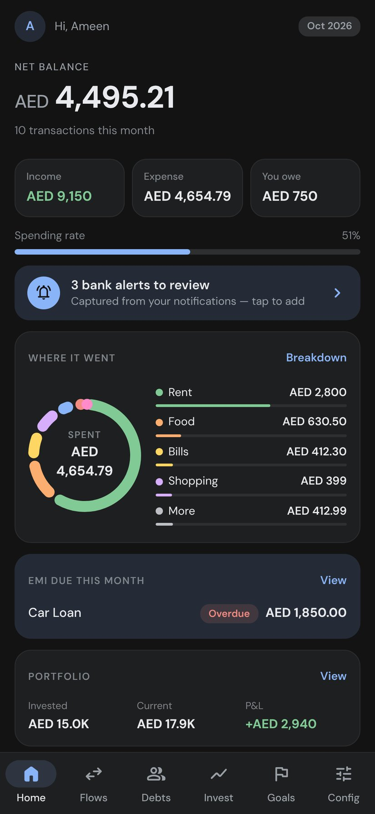
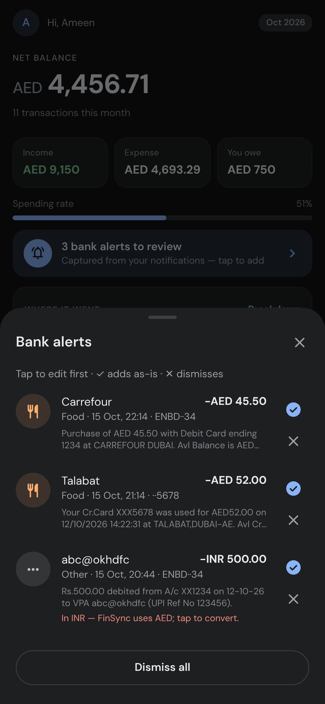
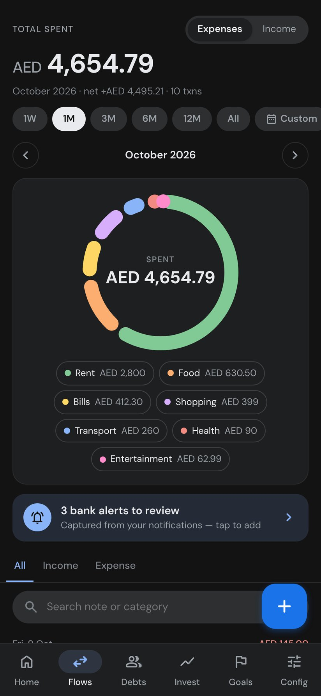
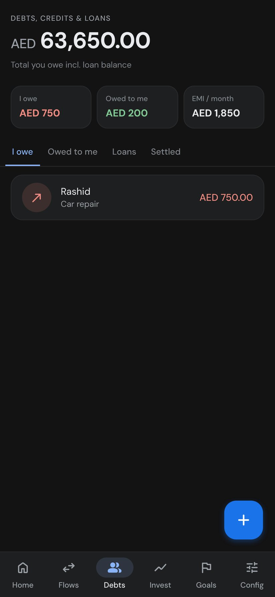
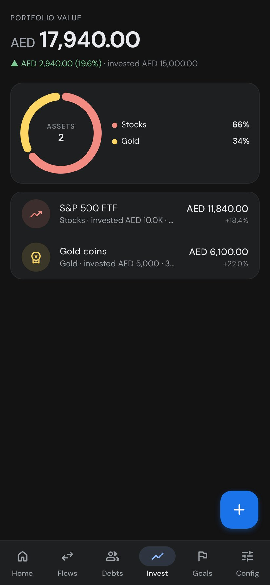
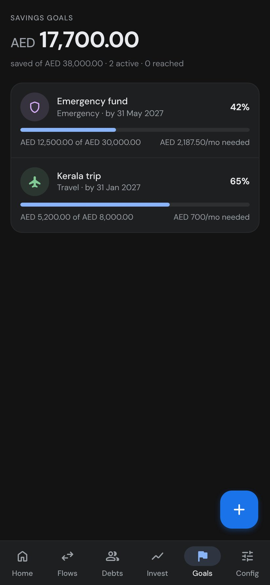

<h1 align="center">FinSync</h1>

<b>Your money in one place, synced to your Google account.</b> 
Expenses, debts and EMIs, investments and savings goals in one Android app.

<a href="../../releases/latest"><b>⬇ Download the latest APK</b></a> · Android 7.0+ · Public beta

  

## Features

- **Home:** net balance, spending rate, a "where it went" donut, EMIs due this month, portfolio and goals.
- **Bank alert capture (optional):** FinSync reads your bank's SMS or notification alerts and turns them into draft expenses. You check each one and tap to add it. It works with ENBD, ADCB, HDFC and many other banks.
- **Flows:** filter by 1W, 1M, 3M, 6M, 12M, All or a custom range. Includes a category breakdown and search.
- **Debts and loans:** what you owe, what you're owed, and loans with EMI tracking.
- **Invest:** portfolio value, profit and loss, and allocation.
- **Goals:** progress toward each goal and how much you need to save each month.
- **Cloud sync:** sign in with Google. Your data is stored in your own Firestore space and works offline.
- **Backup:** export and import JSON. No ads.

  

## Install

1. Open the **[latest release](../../releases/latest)** on your phone and download `FinSync-<version>-beta.apk`.
2. Tap the file. If Android asks, allow your browser to **install unknown apps**. This is normal for apps that don't come from the Play Store.
3. Open FinSync and choose **Continue with Google**.

> **Beta note:** FinSync is also in closed testing on Google Play. The GitHub APK and the Play Store version are signed differently. To switch between them, uninstall the app first. Your data is stored in the cloud, so after you sign in again everything comes back.

## Feedback

Found a bug or have an idea? [Open an issue](../../issues).

## Privacy

[Privacy policy](https://vtameen.github.io/finsync-privacy/)
